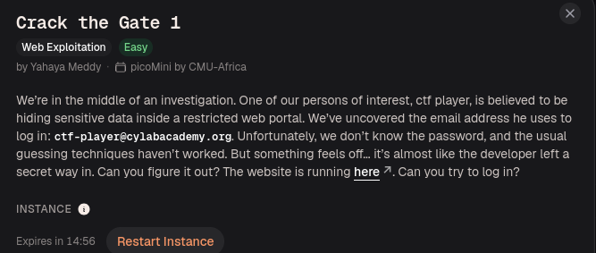
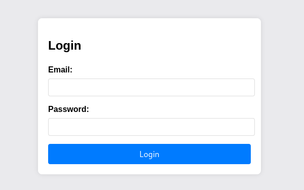
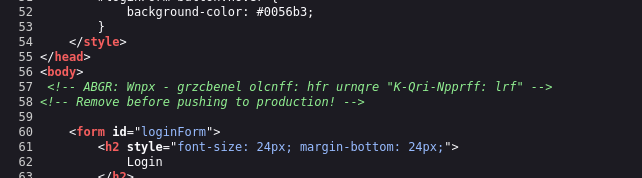
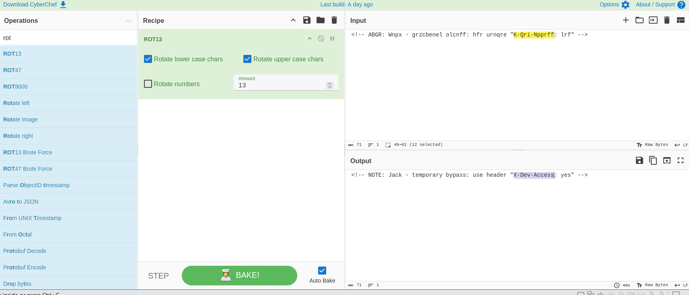
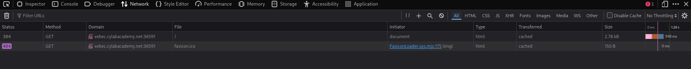
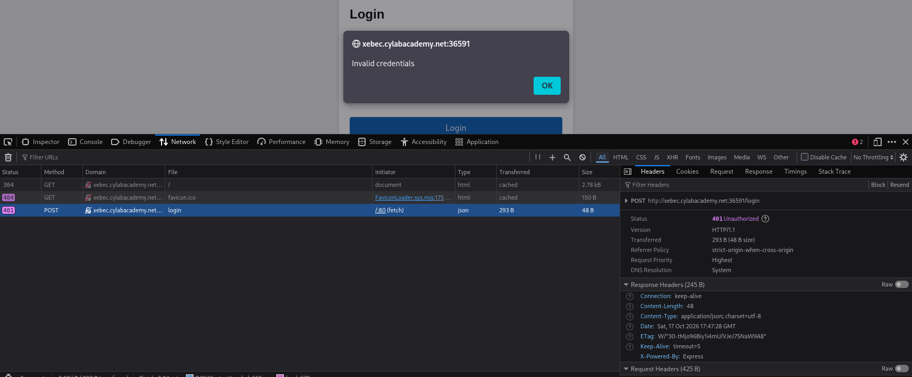
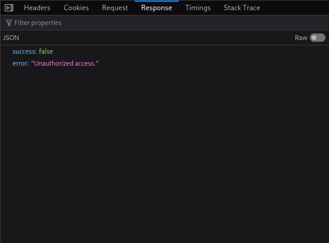
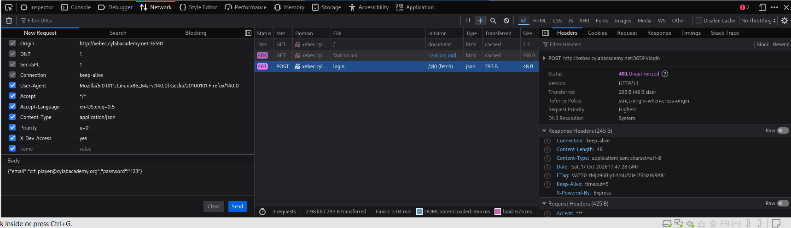
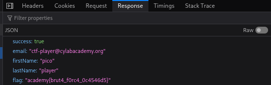

# Authentication Bypass via Exposed Development Header

| Field | Details |
| --- | --- |
| **Challenge** | Crack the Gate 1 |
| **Platform** | CyLab Security Academy (picoCTF) |
| **Event** | picoMini by CMU-Africa |
| **Challenge author** | Yahaya Meddy |
| **Category** | Web Exploitation |
| **Difficulty** | Easy |
| **Primary weakness** | Development authentication bypass left enabled |
| **Relevant CWE** | [CWE-489: Active Debug Code](https://cwe.mitre.org/data/definitions/489.html) |
| **Tools** | Web browser, View Page Source, CyberChef, Firefox Developer Tools |
| **Status** | Solved |

> **Environment note:** The challenge uses temporary instances. Hostnames and ports shown in screenshots may expire or change. This walkthrough documents an authorized CTF exercise, not a test of a production service.

## 1. Challenge Overview

The challenge describes an investigation into a restricted web portal. We are given the email address of a person of interest, but not the password. The prompt explicitly suggests that password guessing is not the intended approach and hints that the developer may have left a secret way into the application.

The information provided is:

```text
Email: ctf-player@cylabacademy.org
Password: Unknown
Goal: Log in to the restricted portal and find the flag.
```



### Initial hypothesis

The wording suggests a **logic flaw or hidden development feature**, rather than a weak password. A sensible first step is to inspect what the website sends to our browser before trying more complicated techniques.

## 2. Reconnaissance: Inspecting the Login Page

Opening the challenge instance reveals a basic login form with two fields: **Email** and **Password**.



We already know the email address from the challenge description, but we do not have a valid password.

Instead of attempting a brute-force attack, I inspected the HTML source using **View Page Source** (`Ctrl+U` in many browsers). This lets us examine the HTML document returned to our browser, including comments that are not visible on the rendered page.

### Suspicious HTML comment

Near the end of the source, I found these comments:

```html
<!-- ABGR: Wnpx - grzcbenel olcnff: hfr urnqre "K-Qri-Npprff: lrf" -->
<!-- Remove before pushing to production! -->
```



Two details make this worth investigating:

1. The second comment explicitly warns that something should be removed before production deployment.
2. The first comment looks deliberately transformed: it has word-like groups, but does not read as ordinary English.

This does **not** prove which encoding was used, but it provides a strong reason to test simple text transformations.

> **Security concept:** HTML comments are not secret. They are sent to the client as part of the page source. Hiding text from the visible interface does not prevent a visitor from reading it.

## 3. Decoding the Hidden Message with ROT13

I copied the suspicious comment into [CyberChef](https://gchq.github.io/CyberChef/) and applied its **ROT13** operation.

### Encoded message

```text
ABGR: Wnpx - grzcbenel olcnff: hfr urnqre "K-Qri-Npprff: lrf"
```

### Decoded message

```text
NOTE: Jack - temporary bypass: use header "X-Dev-Access: yes"
```



We now have a concrete lead: a developer apparently left a temporary authentication bypass that uses a custom HTTP header.

### What is ROT13?

ROT13 is a substitution cipher that replaces each English letter with the letter 13 positions away in the alphabet. For example:

```text
A <-> N
B <-> O
C <-> P
```

Applying ROT13 twice restores the original text. It requires no secret key.

**ROT13 is obfuscation, not secure encryption.** It can conceal a message from casual inspection, but anyone who recognizes the pattern can reverse it immediately.

The important failure here is not the use of ROT13 itself. The real danger is that **a functioning authentication bypass was apparently left in the deployed application**, and its instructions were placed in client-visible HTML.

## 4. Understanding HTTP Headers Before Continuing

To understand the next step, it helps to know what happens when a user submits a login form.

A browser normally sends an HTTP request to the server. That request has several parts:

```http
POST /login HTTP/1.1
Host: <challenge-instance>
Content-Type: application/json

{"email":"ctf-player@cylabacademy.org","password":"123"}
```

The request contains:

- **Method:** `POST`, commonly used to submit data.
- **Path:** `/login`, the endpoint receiving the login attempt.
- **Headers:** Metadata about the request, including `Content-Type`.
- **Body:** The JSON containing the email and password.

The decoded clue asks us to add another request header:

```http
X-Dev-Access: yes
```

`X-Dev-Access` is a **custom header**, not a standard proof of identity. A normal HTTP client can create its own request headers. The server must not treat a user-supplied header as authorization unless a secure, independently verified trust mechanism is in place.

> **Important distinction:** The clue asks for an HTTP **header**, not an extra JSON field in the request body and not a browser cookie.

## 5. Establishing a Baseline: Normal Login Fails

Before testing the bypass, I wanted to see what a normal unsuccessful login looked like.

In Firefox:

1. Press `F12` to open **Developer Tools**.
2. Open the **Network** tab.
3. Refresh the login page to populate the request list.
4. Enter `ctf-player@cylabacademy.org` and an arbitrary test password (`123` in my test).
5. Click **Login**.

The page initially loaded with ordinary requests. The browser also requested a favicon, which returned `404`; that was unrelated to the authentication issue.



After the failed login attempt, Firefox displayed **Invalid credentials** and the Network tab recorded a `POST /login` request with status `401 Unauthorized`.



The server response body contained:

```json
{
  "success": false,
  "error": "Unauthorized access."
}
```



### What does HTTP 401 mean?

`401 Unauthorized` generally indicates that the request lacks valid authentication credentials. Here, that result is expected because we do not know the correct password.

This failed request provides a useful **baseline**. If we repeat the same request with only one relevant change, we can compare the outcomes and identify what affected the application's behavior.

## 6. Testing the Development Bypass

Now I used the clue discovered in the HTML source.

In Firefox Developer Tools:

1. Select the unsuccessful **POST `/login`** request in the **Network** tab.
2. Open the request's **Headers** view and select **Resend** or **Edit and Resend**, depending on the Firefox version.
3. Keep the same destination, email, and arbitrary test password.
4. Add this custom request header:

   ```text
   Header name:  X-Dev-Access
   Header value: yes
   ```

5. Send the modified request.



Conceptually, the request now resembles:

```http
POST /login HTTP/1.1
Host: <challenge-instance>
Content-Type: application/json
X-Dev-Access: yes

{"email":"ctf-player@cylabacademy.org","password":"123"}
```

The **only security-relevant change** is the additional header. We did not discover the account password or use password guessing to authenticate.

### Observed result

The modified request returned HTTP `200 OK`. More importantly, the JSON response changed from `"success": false` to `"success": true` and included the challenge flag:

```json
{
  "success": true,
  "email": "ctf-player@cylabacademy.org",
  "firstName": "pico",
  "lastName": "player",
  "flag": "academy{brut4_f0rc4_0c4546d5}"
}
```



**Flag:**

```text
academy{brut4_f0rc4_0c4546d5}
```

**Challenge solved!**

> A `200` status code alone is not proof that authentication succeeded; some applications return HTTP 200 even for failures. In this challenge, the strongest evidence is the changed JSON response and the returned flag.

## 7. Root Cause: Why Did This Work?

The observed behavior is consistent with a **development-only authentication bypass that remained enabled**.

During development, programmers sometimes add shortcuts for testing features without repeatedly entering credentials. If such a shortcut is mistakenly deployed to an environment accessible to untrusted users, it can undermine the entire login system.

A **simplified illustration** of the vulnerable logic might look like this:

```javascript
// Illustrative pseudocode only; the actual backend source was not examined.
if (request.headers["x-dev-access"] === "yes") {
    return loginSucceededFor(request.body.email);
}

return verifyPassword(request.body.email, request.body.password);
```

We cannot confirm that the challenge server uses this exact code. However, our two observations support the authentication-bypass conclusion:

| Test | Custom header | Observed HTTP status | Response |
| --- | --- | --- | --- |
| Normal login | Absent | `401` | `success: false` |
| Modified login | `X-Dev-Access: yes` | `200` | `success: true` and flag |

### The failure chain

```text
Temporary development bypass created
                 |
                 v
Bypass remains available in deployed application
                 |
                 v
Instructions leak through client-visible HTML
                 |
                 v
ROT13 comment is decoded
                 |
                 v
Attacker adds a client-controlled HTTP header
                 |
                 v
Normal password verification is bypassed
                 |
                 v
Restricted account data is returned
```

Three concepts matter here:

1. **Exposed implementation information:** The HTML comment revealed how the bypass could be triggered.
2. **Active debug behavior:** The server appeared to retain an authentication shortcut intended for development.
3. **Trust boundary failure:** The server accepted a user-controlled header as sufficient to change an authentication decision.

Even removing the HTML comment would **not** fully fix this vulnerability if the bypass remained active. An attacker might discover the header through leaked code, testing, or other sources. The authentication bypass itself must be removed or securely disabled.

## 8. How This Relates to Real-World Cybersecurity

Imagine a company developing an internal customer-support dashboard. During testing, developers add a shortcut that allows a QA engineer to open test accounts without typing passwords.

Before deployment, a developer forgets to remove the shortcut. A note about it also remains in the frontend HTML.

An attacker who discovers the note could reproduce the special request and potentially gain access to customer accounts without their passwords.

Depending on the application, this might expose:

- Customer profiles and personal information.
- Internal support tickets or documents.
- Restricted user or administrator functions.
- Sensitive account settings or business data.

The takeaway is broader than this specific CTF:

**A hidden development switch is not an authentication system. If it can be activated by an untrusted client, it is a security vulnerability.**

### Related weakness classification

- **[CWE-489: Active Debug Code](https://cwe.mitre.org/data/definitions/489.html)** - the best specific match for a development bypass left active.
- **[CWE-287: Improper Authentication](https://cwe.mitre.org/data/definitions/287.html)** - a broader authentication concept; CWE-489 is the more precise primary classification here.
- **[OWASP WSTG-ATHN-04: Bypassing Authentication Schema](https://owasp.github.io/www-project-web-security-testing-guide/latest/4-Web_Application_Security_Testing/04-Authentication/04-Bypassing_Authentication_Schema)** - useful testing guidance for authentication logic failures.

This challenge is **not** an example of password brute forcing, SQL injection, or password cracking. The email was known, and the observed bypass did not require a valid password.

## 9. Remediation and Secure Development Practices

| Security measure | Why it matters |
| --- | --- |
| **Remove debug authentication bypasses before release** | Eliminates alternate paths that skip credential verification. |
| **Never rely on client-controlled headers as proof of identity** | Anyone able to send HTTP requests may supply such a header. |
| **Avoid leaking internal comments or instructions in public assets** | Reduces unnecessary exposure of implementation details, but is not a substitute for removing the bypass. |
| **Add security-focused code review and release checks** | Helps detect forgotten testing switches and temporary shortcuts. |
| **Test negative authentication cases in CI** | Verify that invalid passwords remain rejected even when unusual headers are supplied. |
| **Keep test-only features in isolated nonproduction environments** | Prevents shortcuts intended for QA from affecting real users. |
| **Log and investigate unexpected authentication success** | Helps detect suspicious use of alternate login paths. |

### What would *not* solve the problem by itself?

- **Encoding the comment more strongly:** The dangerous server-side behavior would still exist.
- **Deleting only the comment:** It would hide a clue but leave the bypass available.
- **Using HTTPS:** HTTPS protects traffic in transit; it does not correct broken authentication logic.
- **Renaming the header:** Changing the trigger's name is not a security control.

The correct fix is to ensure authentication decisions are made through the intended, server-validated authentication mechanism.

## 10. Lessons Learned

1. **Read the challenge wording carefully.** A reference to a developer's secret shortcut suggested testing for leftover development functionality rather than brute forcing a password.
2. **Inspect the client-delivered source.** HTML comments may reveal forgotten notes, endpoints, or other useful clues, even when they are not shown in the interface.
3. **Recognize basic encodings.** ROT13 is simple, reversible obfuscation; it does not make sensitive information confidential.
4. **Understand the structure of an HTTP request.** Headers are separate from the method, URL, and body. This distinction mattered directly in the exploit.
5. **Capture a baseline first.** Comparing `401`/`success: false` with `200`/`success: true` provided strong evidence that the custom header changed authentication behavior.
6. **Do not trust client-provided values for authorization.** A custom header can be created or modified by an HTTP client; its presence alone cannot prove a user's identity.
7. **Separate observation from inference.** We observed the responses and exposed developer note; we did not inspect the server-side source code.
8. **Document the root cause and remediation.** A high-quality pentesting report explains not just how a test succeeded, but what developers must change to prevent it.

## Conclusion

In **Crack the Gate 1**, I identified an encoded HTML comment that revealed a temporary development authentication bypass. After decoding the message with ROT13, I used Firefox Developer Tools to resend a failed login request with the custom `X-Dev-Access: yes` header.

The server then returned a successful response and the challenge flag, even though I had not obtained the user's password.

The core issue was an **active development authentication bypass accessible through a client-controlled HTTP header**, with a source-code comment providing the instructions.

This challenge demonstrates why secure release practices, proper authentication design, and careful inspection of client-exposed information are important in web application security.

---

## References

- [MITRE CWE-489: Active Debug Code](https://cwe.mitre.org/data/definitions/489.html)
- [MITRE CWE-287: Improper Authentication](https://cwe.mitre.org/data/definitions/287.html)
- [OWASP Web Security Testing Guide: Bypassing Authentication Schema](https://owasp.github.io/www-project-web-security-testing-guide/latest/4-Web_Application_Security_Testing/04-Authentication/04-Bypassing_Authentication_Schema)
- [OWASP Authentication Cheat Sheet](https://cheatsheetseries.owasp.org/cheatsheets/Authentication_Cheat_Sheet.html)
- [CyberChef](https://gchq.github.io/CyberChef/)

> **Ethics and publication:** This is a writeup of an authorized CTF exercise. Test only systems you own or have permission to assess, and publish challenge solutions only when the event or platform rules allow it.
