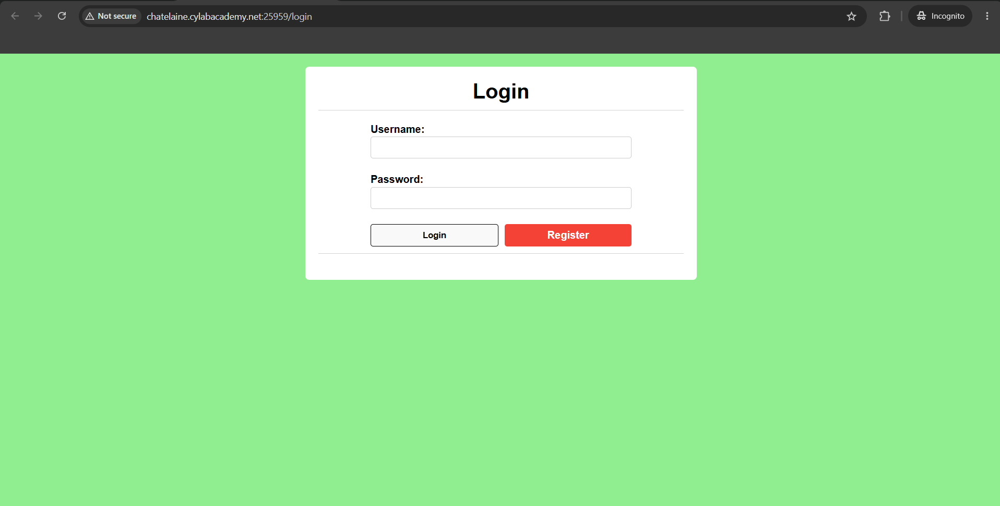
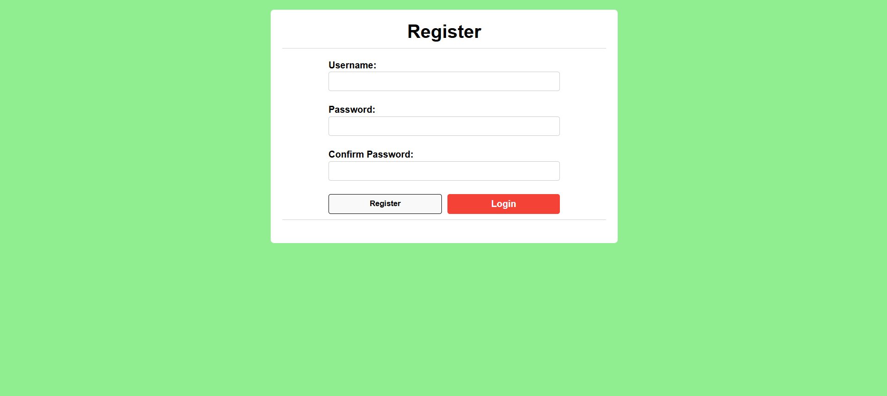
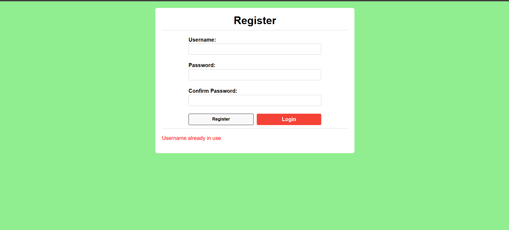
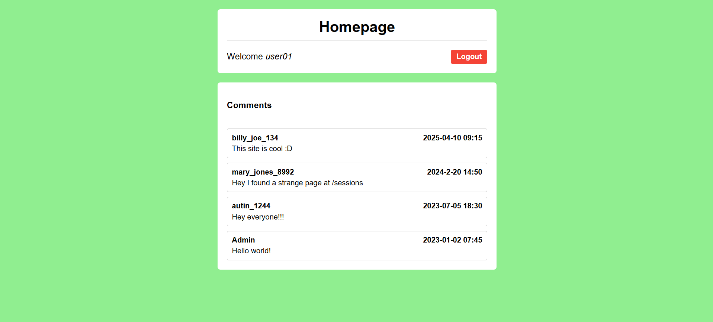
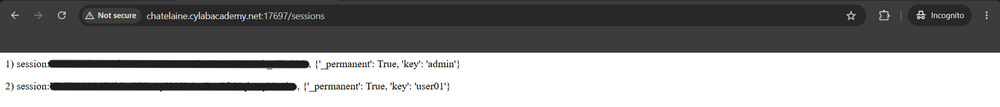
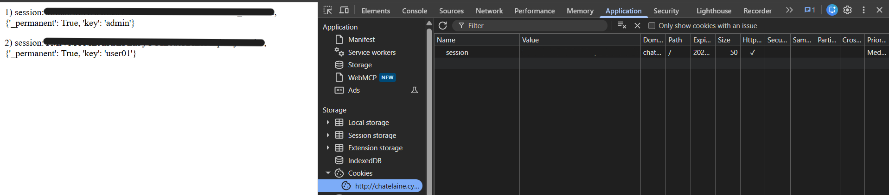
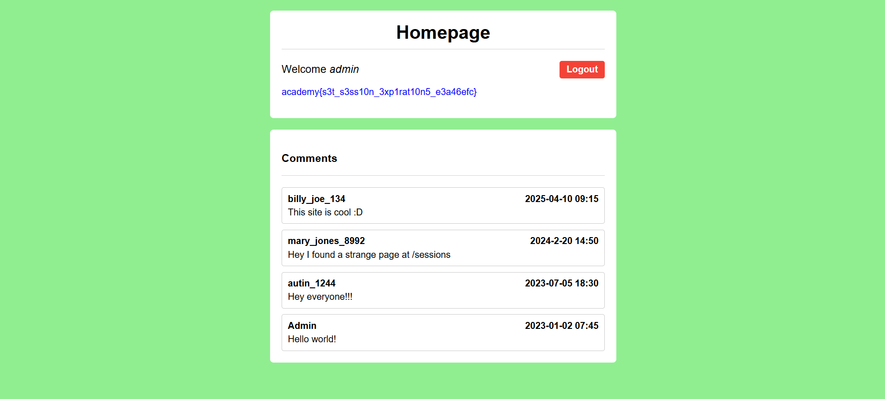

# Session Hijacking via Exposed Session IDs

**Challenge:** Old Sessions  
**Platform:** CyLab Security Academy (picoCTF)  
**Category:** Web Exploitation  
**Difficulty:** Easy  
**Tools:** Web Browser, Chrome Developer Tools  
**Vulnerability:** Session Hijacking / Sensitive Session Information Disclosure

---

## 1. Challenge Overview

The challenge introduces an important web security concept: **session management**.

When users authenticate to a website, the server typically creates a session to remember their identity. Instead of requiring users to enter their credentials for every request, the browser sends a session cookie that allows the server to recognize them.

However, poorly implemented session management can introduce serious security vulnerabilities.

In this challenge, the website's developer mentions that users should not have to log in repeatedly. This suggests that the application uses persistent sessions, making session handling an interesting area to investigate.

**Objective:** Identify a weakness in the application's session management and retrieve the flag.

> **Note:** The challenge runs on an instance-specific URL. The hostname and port may change, so use the URL provided by your own challenge instance.

## 2. Initial Reconnaissance

After opening the challenge website, we are presented with a login page containing two input fields:

- Username
- Password

There are also two buttons: **Login** and **Register**.



Since we do not have valid login credentials, we can begin by registering a new account.

Click **Register** to access the registration page.



For this challenge, I created a test account using the following credentials:

| Field | Value |
|---|---|
| Username | `user01` |
| Password | `user01` |

These are disposable credentials for the CTF environment only. Real-world accounts should use strong, unique passwords.

### Additional observation: Existing username

During testing, I also attempted to register an account using the username `admin`.

The application returned:

```text
Username already in use
```



This indicates that the username is unavailable, potentially because the account already exists. However, this response alone does not confirm the account's privileges.

The behavior is also an example of how registration errors can reveal information about existing usernames, a concept known as **username enumeration**.

We will continue using our own test account.

## 3. Investigating the Application

After registering, log in with the newly created account.

The application redirects us to the homepage, displaying:

```text
Welcome user01
```

Below the welcome message is a comments section containing messages from several users.



One particular comment stands out:

```text
mary_jones_8992:
Hey I found a strange page at /sessions
```

This is an interesting discovery.

In web penetration testing, information exposed through comments, application interfaces, and other publicly accessible content can provide useful clues about hidden functionality.

Since the application uses sessions, the `/sessions` path is especially relevant.

Let's investigate it.

## 4. Discovering the Exposed Sessions

Navigate to the following endpoint using the current challenge instance:

```text
http://<CHALLENGE-HOST>:<PORT>/sessions
```

For example, append `/sessions` to the URL of the running website.

The page displays session information resembling the following:

```text
1) session:<REDACTED_ADMIN_SESSION>,
   {'_permanent': True, 'key': 'admin'}

2) session:<REDACTED_USER_SESSION>,
   {'_permanent': True, 'key': 'user01'}
```



This is the key discovery.

The endpoint reveals session identifiers associated with different users, including `admin` and our own account, `user01`.

### Why is this dangerous?

A session identifier is effectively a temporary authentication credential.

When a user successfully logs in, the application associates a session identifier with that user's authenticated state.

On subsequent requests, the browser sends the session cookie, allowing the server to recognize the user without requiring another password.

A simplified authentication flow looks like this:

```text
User logs in
     |
     v
Server creates an authenticated session
     |
     v
Browser receives a session cookie
     |
     v
Browser sends the cookie with future requests
     |
     v
Server identifies the authenticated user
```

If an attacker obtains another user's valid session identifier, they may be able to impersonate that user without knowing their username and password.

This is known as **session hijacking**.

### What does `_permanent: True` mean?

The exposed session data also contains:

```python
'_permanent': True
```

This suggests that the application has enabled persistent-session behavior.

However, the flag does not necessarily mean the session lasts forever. Actual expiration depends on the application's session configuration and how the server validates and revokes sessions.

The vulnerability demonstrated here is that another user's valid session identifier is exposed and can be reused.

## 5. Inspecting Our Session Cookie

Now that we know the application exposes session identifiers, let's investigate how the browser stores our own session.

In Google Chrome:

1. Press `F12` to open Developer Tools.
2. Select the **Application** tab.
3. Expand **Cookies** under Storage.
4. Select the challenge website.
5. Locate the cookie named `session`.



The browser stores a session cookie with a value resembling:

```text
Name:  session
Value: <REDACTED_USER_SESSION>
```

Compare this value with the session identifier associated with `user01` on the `/sessions` page.

The identifiers match.

This confirms that the session identifier displayed by the application corresponds to the authentication cookie used by our browser.

### Important concept: Session cookies

Cookies are small pieces of data stored by browsers and sent to websites with matching requests.

An authentication session cookie is particularly sensitive because the server may rely on it to identify the logged-in user.

**Whoever possesses a valid session identifier may be able to act as its associated user, depending on the application's security controls.**

Importantly, an attacker does not need to guess a cryptographically strong session identifier if the application exposes it directly.

## 6. Session Hijacking

We have now established two important facts:

1. The `/sessions` endpoint exposes a session identifier associated with `admin`.
2. Our browser uses the `session` cookie to maintain our authenticated identity.

We can test whether the application accepts the exposed administrator session identifier.

While inside the authorized CTF environment:

1. Open Chrome Developer Tools.
2. Navigate to **Application → Cookies**.
3. Find the cookie named `session`.
4. Double-click its **Value** field, or right-click and choose **Edit Value**.
5. Replace our session identifier with the administrator's identifier obtained from `/sessions`.
6. Press `Enter` to save the modified value.
7. Return to the application's homepage and refresh it.

The browser now sends the administrator's session identifier with the request.

If the server accepts that identifier without additional verification, it treats the request as belonging to the administrator.

### Result

After refreshing the homepage, the application displays:

```text
Welcome admin
```

The administrator's page also reveals the challenge flag.



**Flag:**

```text
academy{s3t_s3ss10n_3xp1rat10n5_e3a46efc}
```

**Challenge solved!**

## 7. Understanding the Vulnerability

### What went wrong?

The application exposed authenticated session identifiers through the `/sessions` endpoint.

An ordinary authenticated user was able to retrieve a session identifier belonging to an administrator.

By replacing their own session cookie with the administrator's identifier, the user could impersonate the administrator.

This is possible because the server accepts possession of the valid session identifier as evidence of an authenticated session.

### Attack flow

```text
Attacker creates a normal account
              |
              v
Attacker discovers /sessions
              |
              v
Endpoint exposes an admin session ID
              |
              v
Attacker replaces their session cookie
              |
              v
Browser sends the admin session ID
              |
              v
Server recognizes the admin session
              |
              v
Attacker gains admin account access
```

### Security weaknesses

The findings relate to several important security concepts:

| Concept | Explanation |
|---|---|
| Sensitive Information Disclosure | The application exposes authentication session identifiers. |
| Broken Access Control | An ordinary user can access session information belonging to other users. |
| Session Hijacking | A valid session identifier is reused to impersonate another user. |
| Persistent Sessions | Long session lifetimes can increase the period during which stolen sessions remain usable. |

Relevant Common Weakness Enumeration references include:

- **CWE-200:** Exposure of Sensitive Information to an Unauthorized Actor.
- **CWE-862:** Missing Authorization.
- **CWE-613:** Insufficient Session Expiration — relevant to the challenge theme, although the exact session lifetime was not independently tested.

## 8. Real-World Impact

Similar vulnerabilities can have serious consequences in real-world applications.

For example, imagine an employee logs in to a company's internal administration dashboard.

If the employee's session identifier is exposed through a debugging endpoint, application logs, or another security weakness, an attacker who obtains it may be able to access the employee's account.

If the session remains valid for an extended period, the attacker may retain access until the session expires or is revoked.

Potential consequences include:

- Unauthorized access to user accounts.
- Exposure of confidential information.
- Privilege escalation through administrator impersonation.
- Unauthorized actions performed using a victim's authenticated session.

The critical issue is not simply that a session exists for a long time.

**The danger comes from exposing valid authentication credentials and allowing those credentials to be reused.**

## 9. Mitigation and Best Practices

Developers should implement multiple security controls to protect authenticated sessions.

### 9.1 Protect session identifiers

Session identifiers must never be exposed to unauthorized users.

Debugging endpoints such as `/sessions` should not expose real authentication tokens in production environments.

Any exposed sessions should be revoked and replaced.

### 9.2 Implement appropriate session expiration

Applications should enforce session lifetime controls, including:

- **Idle timeout:** Expire sessions after a period of inactivity.
- **Absolute timeout:** Require reauthentication after a maximum session lifetime, even if the user remains active.
- **Logout invalidation:** Revoke authenticated sessions when users log out.

### 9.3 Secure authentication cookies

Where applicable, authentication cookies should use appropriate security attributes.

| Attribute | Purpose |
|---|---|
| `HttpOnly` | Prevents JavaScript from reading the cookie through `document.cookie`. |
| `Secure` | Restricts transmission to secure HTTPS connections. |
| `SameSite` | Helps limit cross-site cookie transmission and certain CSRF risks. |

These protections are valuable but do not replace server-side authorization or proper session handling.

For example, `HttpOnly` does not prevent a user from editing cookies through browser developer tools, nor does it stop a vulnerable server endpoint from directly exposing session identifiers.

### 9.4 Strengthen session management

Applications should also generate unpredictable session identifiers, rotate session IDs after authentication or significant privilege changes, and provide appropriate mechanisms for revoking compromised sessions.

### 9.5 Enforce authorization controls

Endpoints exposing sensitive administrative information must implement appropriate authorization checks.

A regular user should never be able to retrieve another user's active authentication session.

## 10. Lessons Learned

This challenge demonstrates several important lessons for web penetration testing.

**1. Pay attention to the challenge description.**

The developer's unusual preference for never logging out hinted that session management was worth investigating.

**2. Enumeration is not limited to automated tools.**

Useful information can also appear in comments, web pages, application responses, and other accessible content.

**3. Understand how authentication works.**

A session cookie can represent an authenticated identity. Protecting this cookie is just as important as protecting account credentials.

**4. Session hijacking does not necessarily require knowing a password.**

When an application exposes valid session tokens, attackers may be able to impersonate other users without obtaining their passwords.

**5. Different security weaknesses can combine to create a larger vulnerability.**

In this case, session identifier disclosure, insufficient authorization, and potentially persistent sessions combine to create an account takeover risk.

## Conclusion

By carefully inspecting the application's functionality, we discovered an exposed `/sessions` endpoint containing session identifiers for multiple accounts.

We verified that the identifiers matched the browser's authentication cookie and demonstrated that replacing our own session identifier with the administrator's allowed access to the administrator's account.

This challenge highlights why secure session management, appropriate expiration policies, and strong server-side authorization are essential for web application security.


---

## Additional Research

For an alternative reconnaissance approach, I also used Gobuster,
ffuf, and feroxbuster to discover the `/sessions` endpoint without
relying on the original challenge hint.

**[Read: Automated Web Content Enumeration](web-content-enumeration.md)**

---

**Disclaimer:** This walkthrough documents a controlled cybersecurity training challenge. All testing was performed within the intended CTF environment. Techniques should only be used on systems where testing is explicitly authorized.
