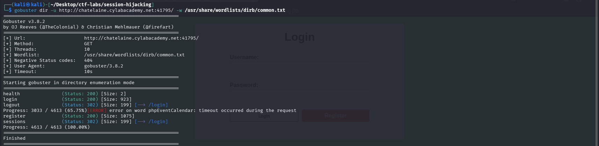
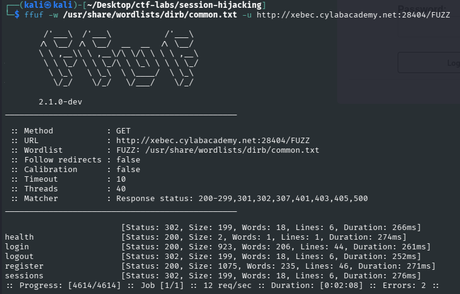
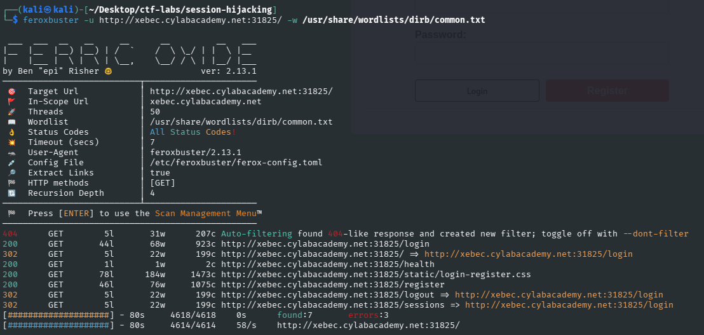

# Alternative Reconnaissance: Web Content Enumeration

> **Companion investigation:** [Session Hijacking - Original Challenge Writeup](README.md)
>
> This document explores a second way to **discover** the vulnerable `/sessions` endpoint. It does not replace the original, simpler solution or repeat the steps used to capture the flag.

| Field | Details |
| --- | --- |
| Platform | CyLab Security Academy (picoCTF) |
| Category | Web Exploitation |
| Difficulty | Easy |
| Focus | Unauthenticated web content enumeration |
| Tools | Gobuster 3.8.2, ffuf 2.1.0-dev, feroxbuster 2.13.1 |
| Wordlist | `/usr/share/wordlists/dirb/common.txt` |

## 1. Objective

In the [original walkthrough](README.md), a comment on the website's homepage mentioned `/sessions`. Following that clue was the easiest way to solve the challenge.

But what if that comment did not exist? Could we still find the endpoint?

To test this, I used three web content discovery tools on my **assigned CTF instances**. The objective was to locate `/sessions` by enumerating possible URLs, without relying on the homepage hint.

**Result:** All three tools identified `/sessions`. None of these unauthenticated scans, by itself, revealed the session identifiers or captured the flag.

> **Scope:** These commands were executed only against the provided training instances. The hostnames and ports were temporary and may now be expired. Use automated scanning only where you have permission, and respect the target's rules and rate limits.

## 2. How Wordlist-Based Enumeration Works

A directory or content discovery tool reads candidate path names from a wordlist and requests each path from the server.

For example, a wordlist containing:

```text
admin
login
register
sessions
```

may lead to these requests:

```text
GET /admin
GET /login
GET /register
GET /sessions
```

The tool then reports useful details such as HTTP status codes, redirects, response sizes, and request errors.

I used Kali Linux's common DIRB wordlist:

```text
/usr/share/wordlists/dirb/common.txt
```

To check whether that wordlist includes the target path:

```bash
grep -nFx sessions /usr/share/wordlists/dirb/common.txt
```

This matters because **wordlist-based discovery only tests the candidates it is given** (unless the tool also extracts new paths or uses other discovery features). An endpoint can exist and still be missed.

## 3. Gobuster

**Gobuster** is a straightforward command-line tool for enumerating web paths.

### Command executed

```bash
gobuster dir -u http://chatelaine.cylabacademy.net:41795/ -w /usr/share/wordlists/dirb/common.txt
```

- `dir`: use directory/content enumeration mode.
- `-u`: specify the target URL.
- `-w`: specify the wordlist.

### Findings

```text
health     (Status: 200) [Size: 2]
login      (Status: 200) [Size: 923]
logout     (Status: 302) [Size: 199] [--> /login]
register   (Status: 200) [Size: 1075]
sessions   (Status: 302) [Size: 199] [--> /login]
```



**Observation:** Gobuster found `/sessions`, which redirected to `/login` with HTTP `302`. The scan also recorded one request timeout for another wordlist entry. Its screenshot shows the scan finished but does **not** record an elapsed time, so its total duration is unknown.

## 4. ffuf

**ffuf** is a flexible HTTP fuzzing tool. For path discovery, the keyword `FUZZ` identifies where each wordlist entry should be inserted.

### Command executed

```bash
ffuf -w /usr/share/wordlists/dirb/common.txt -u http://xebec.cylabacademy.net:28404/FUZZ
```

- `-w`: specify the wordlist.
- `-u`: specify the target URL.
- `FUZZ`: replace this marker with one candidate from the wordlist per request.

For example, the word `sessions` results in a request to `/sessions`.

### Findings

```text
health      [Status: 200, Size: 2]
login       [Status: 200, Size: 923]
logout      [Status: 302, Size: 199]
register    [Status: 200, Size: 1075]
sessions    [Status: 302, Size: 199]
```



**Observation:** ffuf also found `/sessions` with HTTP `302`. Its terminal output recorded **2 minutes 8 seconds** and **2 request errors**.

A beginner gotcha: omitting `/FUZZ` from the URL prevents ffuf from knowing where to insert the wordlist entries. The corrected command above includes it.

## 5. feroxbuster

**feroxbuster** is a web content discovery tool with recursive scanning capabilities. It can explore additional directories and resources encountered during enumeration.

### Command executed

```bash
feroxbuster -u http://xebec.cylabacademy.net:31825/ -w /usr/share/wordlists/dirb/common.txt
```

- `-u`: specify the target URL.
- `-w`: specify the wordlist.

### Findings

```text
200 GET /login
302 GET / -> /login
200 GET /health
200 GET /static/login-register.css
200 GET /register
302 GET /logout -> /login
302 GET /sessions -> /login
```



**Observation:** feroxbuster found `/sessions` and an additional static stylesheet (`/static/login-register.css`). Its terminal output recorded **80 seconds**, **7 findings**, and **3 request errors**. The reported findings include the root redirect and static resource, so counts should not be interpreted as equivalent across tools.

## 6. Comparison of the Actual Scans

| Tool | Found `/sessions`? | Response for `/sessions` | Time shown in screenshot | Errors shown |
| --- | --- | --- | --- | --- |
| Gobuster | Yes | `302 -> /login` | Not recorded | 1 timeout shown |
| ffuf | Yes | `302` | 2 min 8 sec (128 s) | 2 |
| feroxbuster | Yes | `302 -> /login` | 1 min 20 sec (80 s) | 3 |

**For these particular runs, feroxbuster finished faster than ffuf.** Gobuster cannot be ranked because its elapsed time was not captured.

This is **not a controlled benchmark**. The commands used different default thread counts and features, and the scans ran against different temporary instances. Network conditions and server response times may also have varied. We can compare what happened in our screenshots, but cannot declare any tool universally fastest.

For a future controlled comparison, keep the target, wordlist, concurrency, rate limits, and scan options consistent. The shell's `time` command can help capture duration:

```bash
time gobuster dir -u http://YOUR-ASSIGNED-INSTANCE/ -w /usr/share/wordlists/dirb/common.txt
```

## 7. Why Did `/sessions` Redirect to `/login`?

All three discovery tools sent requests **without an authenticated browser session**. They therefore observed a redirect for `/sessions`:

```text
GET /sessions
HTTP 302 -> /login
```

In the [original writeup](README.md), I accessed `/sessions` **after logging in** with my own test account. The endpoint then disclosed session identifiers associated with multiple accounts, including an administrator.

This illustrates the difference between two fundamental security concepts:

- **Authentication:** Is the user logged in? An unauthenticated request to `/sessions` was redirected to `/login`.
- **Authorization:** Is the logged-in user allowed to access this specific data? The application exposed other users' sensitive session information to an ordinary authenticated account.

The vulnerability was therefore **not simply that `/sessions` existed**. The problem was the application's improper handling of sensitive session information and access control.

An HTTP `302`, `200`, or `403` result is a discovery clue, **not proof of a vulnerability**. Relevant endpoints still require careful investigation within the authorized scope.

## 8. What This Teaches About Real-World Pentesting

Manual and automated reconnaissance are complementary:

1. **Understand the application.** Browse its features, read visible content, and map important functionality.
2. **Discover additional paths.** Use appropriate wordlists and tools to locate unlinked endpoints and static resources.
3. **Interpret responses.** Note redirects, response sizes, errors, and access restrictions instead of relying on status codes alone.
4. **Assess authorization.** Where permitted, verify whether authenticated users can access resources or information outside their privileges.
5. **Document reproducible evidence.** Record the exact commands, relevant outputs, scope, and limitations of the testing.

These tools serve different purposes:

| Tool | Why I might choose it |
| --- | --- |
| **Gobuster** | Simple, readable path enumeration |
| **ffuf** | Flexible placement of fuzzing inputs, using markers such as `FUZZ` |
| **feroxbuster** | Convenient discovery of nested web content through recursion |

No single tool replaces understanding the application or validating a security finding. In real engagements, automated scans should be coordinated with the rules of engagement and use appropriate rate limits to avoid disrupting the service.

## 9. Conclusion

The original CTF solution remains the easiest way to capture the flag. This alternative investigation answers a separate question: **Can an unlinked, security-relevant endpoint be discovered systematically?**

Using Gobuster, ffuf, and feroxbuster, I independently identified `/sessions` with three different tools. The observed redirects also helped demonstrate the distinction between an authentication requirement and broken authorization *after* login.

The main takeaway is that **content discovery finds leads; thoughtful validation turns those leads into defensible security findings**.

---

**Evidence note:** The screenshots above should be stored in the same challenge's `images/` directory. Review screenshots and terminal logs before committing them; do not publish session cookies, credentials, or other live authentication tokens.

[Back to the original challenge writeup](README.md)
